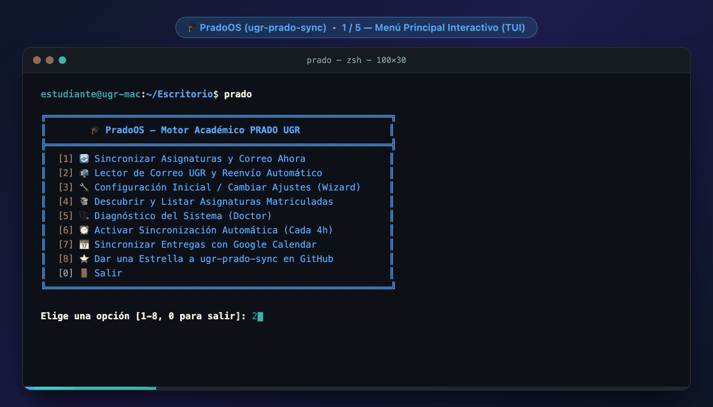
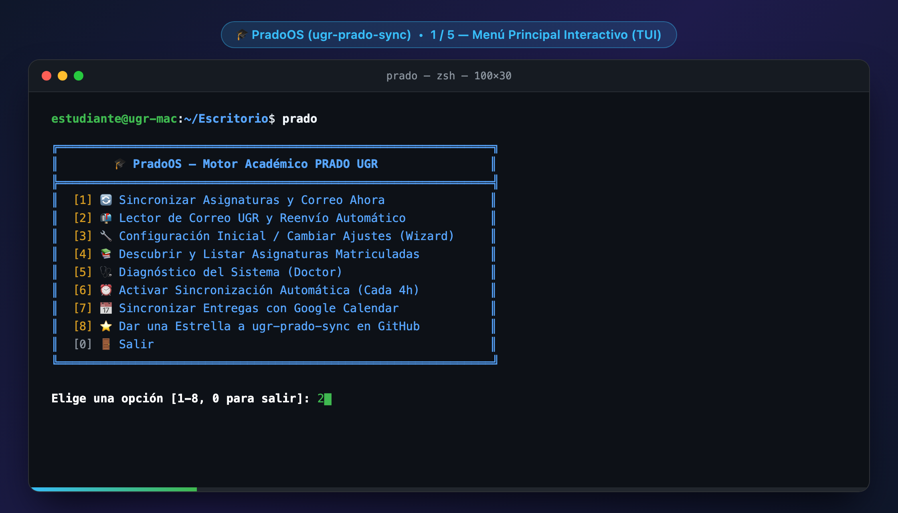
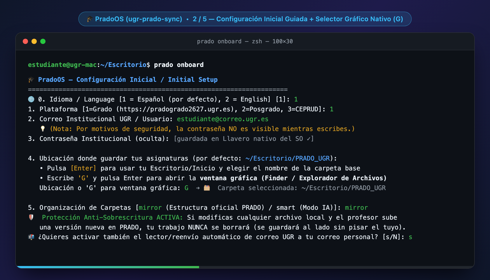
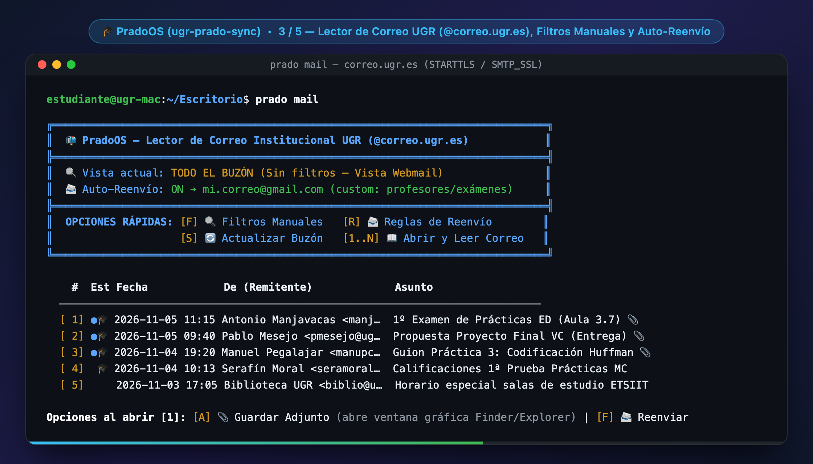
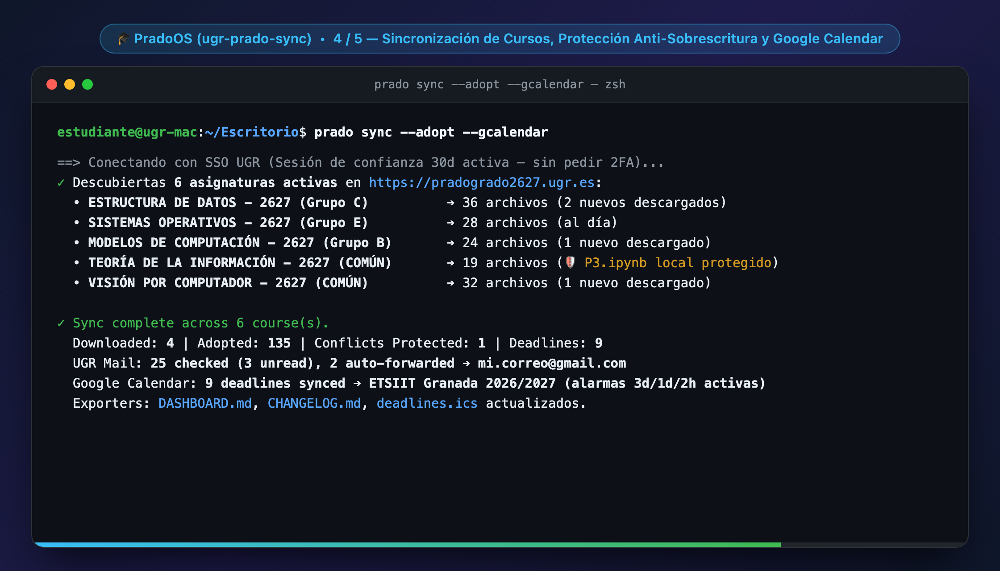
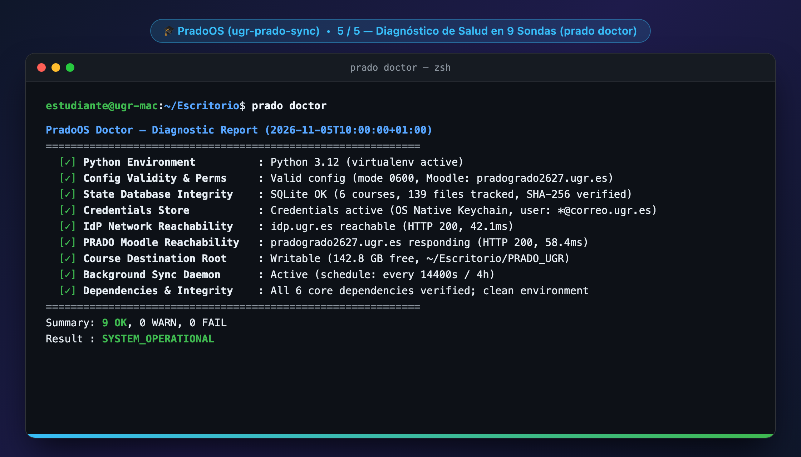

# 🎓 PradoOS (`prado-os`)

**El motor de sincronización y flujo académico inteligente para PRADO UGR (`pradogrado`, `pradoposgrado`, `prado.ugr.es`) y Moodle.**  
*Disponible para macOS, Linux Desktop y Windows.*

[](https://pypi.org/project/prado-os/)
[](https://github.com/LorSt4r/prado-os/releases)
[](https://www.python.org/)
[](LICENSE)
[](#)
[](https://github.com/LorSt4r/prado-os/actions)
[](https://github.com/LorSt4r/prado-os/actions)

> 🌐 **Idiomas / Languages / Lingue / Langues:** [🇪🇸 Español (Principal)](#-documentación-en-español) | [🇬🇧 English](#-english-documentation) | [🇮🇹 Italiano](docs/README.it.md) | [🇫🇷 Français](docs/README.fr.md)

<p align="center">
  
</p>

<details>
<summary>📸 <b>Ver galería completa de interfaces (Menú TUI, Asistente de Onboarding, Lector de Correo UGR, Sincronización Incremental y Doctor)</b></summary>
<br>

#### 1. Menú Interactivo Principal (`prado`)


#### 2. Asistente de Configuración Guiado en 2 Fases (`prado onboard`)


#### 3. Lector TUI de Correo UGR y Auto-Reenvío Selectivo (`prado mail`)


#### 4. Sincronización Incremental con Protección Anti-Sobrescritura y `DASHBOARD.md` (`prado sync --adopt`)


#### 5. Diagnóstico Integral de Salud y Daemon Multiplataforma (`prado doctor` / `prado daemon`)


</details>

---

## 👥 Autoría y AI Disclosure

### 🇮🇹 De una Necesidad Real en Granada a un Proyecto Open-Source
**PradoOS** fue desarrollado por **Lorenzo Vasile**, estudiante de Ingeniería Informática de la *Università degli Studi di Palermo (UniPa)* durante su estancia **Erasmus+** en la *Universidad de Granada (UGR, ETSIIT)* (Curso 2026/2027).  
Al compaginar múltiples asignaturas de distintos departamentos (Estructura de Datos, Modelos de Computación, Visión por Computador, Teoría de la Información y Sistemas Operativos), surgió la necesidad de optimizar el tiempo de estudio y **eliminar por completo las pérdidas de tiempo manuales**: descargar PDFs uno a uno, revisar foros repetitivamente, reorganizar carpetas y vigilar fechas de entrega dispersas.

### 🤖 AI Disclosure & Proceso de Desarrollo
Este proyecto fue diseñado e implementado mediante pair programming asistido por inteligencia artificial con **Google Antigravity**:
- **Lorenzo Vasile**: concepción del proyecto, definición de requisitos funcionales y de seguridad (aislamiento de credenciales en el Llavero nativo, flujo SAML/MFA sin contraseñas en texto plano, protección anti-sobrescritura) y validación en entornos reales (**macOS**, **Linux** y **Windows**).
- **Stack de IA (Google Antigravity)**: se utilizó **Gemini 4 Argon** para el diseño de la arquitectura modular, análisis de seguridad y verificación, y **Gemini 3.8 Flash** para la generación ágil de código, la suite de tests automatizados (714 tests + suite E2E real sin mocks) y los pipelines de CI multiplataforma.

---

## 🇪🇸 Documentación en Español

### 💡 ¿Qué hace PradoOS por ti? (Sencillo, Claro e Impactante)

Si estudias en la Universidad de Granada, PradoOS resuelve en segundo plano todo lo que antes hacías a mano:

1. 📥 **Tus asignaturas siempre al día en tu ordenador, sin mover un dedo:**  
   PradoOS detecta automáticamente todas las asignaturas en las que estás matriculado en PRADO (`pradogrado`, `pradoposgrado` o `ceprud`) y descarga transparencias, apuntes y guiones de prácticas a tu carpeta local.
2. 🛡️ **Jamás pierdes ni se sobrescribe tu trabajo:**  
   Si resuelves una práctica, modificas un notebook `.ipynb` o compilas código `.cpp` y más tarde el profesor sube una corrección a PRADO, **tu archivo nunca se borra ni se sobreescribe**. PradoOS detecta tu modificación mediante hash SHA-256 y guarda la versión del profesor al lado como `{archivo}_server_{fecha}.ext`.
3. 📅 **Tus entregas y exámenes directos a Google Calendar:**  
   Olvídate de revisar PRADO para ver cuándo vence una tarea. PradoOS envía tus fechas límite directamente a tu Google Calendar universitario (`ETSIIT Granada` o calendario principal) con alarmas popup inteligentes: **3 días, 1 día y 2 horas antes para exámenes**; **2 días, 1 día y 3 horas antes para prácticas**.
4. 🔑 **Sin pedirte la contraseña todos los días:**  
   Gracias a su soporte del token de dispositivo de confianza (`MFA_TOKEN`), solo introduces tu segundo factor una vez cada 30 días. Tu contraseña se guarda en el Llavero nativo de tu sistema operativo (macOS Keychain, Windows Credential Manager o Linux SecretService), jamás en texto plano.
5. 📂 **Organización natural y selector gráfico nativo (Finder / Explorador de Archivos):**  
   - **Por defecto (`mirror`):** mantiene los **nombres oficiales de tus asignaturas en PRADO** y replica exactamente las secciones creadas por cada profesor.  
   - **Modo IA (`smart`):** separa automáticamente `Teoria/`, `Practicas/P1..Pn/` y `General/` (ideal si utilizas un agente de IA).  
   - **Sin escribir rutas a mano:** detecta automáticamente tu Escritorio/Inicio localizado (en español, italiano o inglés) y te permite pulsar **`G`** durante la configuración para elegir dónde guardar tu carpeta mediante la **ventana gráfica nativa de tu sistema (Finder en macOS, Explorador de Archivos en Windows, Zenity/KDialog en Linux)**.
6. 📬 **Lector TUI de Correo UGR (`@correo.ugr.es`) y Reenvío Automático a tu Correo Personal (`prado mail`):**  
   - Lee tu buzón institucional directamente en terminal (`correo.ugr.es:993` vía `IMAP4_SSL`) reutilizando tus credenciales ya guardadas: muestra por defecto todo tu buzón igual que Webmail, te permite aplicar filtros rápidos por profesor o palabra clave (`[F]`), **no marca tus correos como leídos en segundo plano** (`BODY.PEEK[]`, solo los marca como leídos cuando tú abres un correo concreto), y al descargar archivos adjuntos (`📎`) **abre siempre la ventana gráfica nativa de carpetas** para que elijas dónde guardarlos.
   - **Reenvío selectivo automático (`[R]`):** configura qué profesores o asignaturas te interesan y PradoOS reenviará automáticamente sus correos (con adjuntos incluidos) a tu cuenta personal (`@gmail.com`, `@icloud.com`, `@outlook.com`) a través de `correo.ugr.es:465` (`SMTP_SSL`).

---

### 🔒 Arquitectura de Seguridad, Privacidad Local y Uso Responsable de PRADO

**PradoOS** ha sido diseñado aplicando buenas prácticas de seguridad local y respeto técnico hacia la infraestructura de **PRADO (CEPRUD)**:

1. 🔒 **Privacidad y Seguridad 100 % Local (Cero Servidores Externos ni Telemetría):**
   - Toda la ejecución ocurre íntegramente en el ordenador del estudiante. **No existe ningún servidor intermedio, nube de terceros ni recolección de telemetría.**
   - La comunicación se realiza exclusivamente mediante conexiones HTTPS/TLS directas contra los dominios oficiales de la universidad (`*.ugr.es`: `pradogrado2526.ugr.es`, `pradoposgrado2526.ugr.es`, `prado.ugr.es`, `sts.ugr.es`, `correo.ugr.es`).
   - Las credenciales de *Acceso Identificado* jamás se guardan en texto plano ni en archivos de configuración: se almacenan exclusivamente en el llavero criptográfico nativo del sistema operativo (**macOS Keychain**, **Windows Credential Manager** o **Linux SecretService / libsecret**), respetando íntegramente el flujo SAML oficial y el doble factor de autenticación (**MFA**).
2. ⚡ **Carga Mínima y Protección de los Servidores de PRADO (Deduplicación Inteligente):**
   - **Descarga única por archivo (`SHA-256` + SQLite local):** cada recurso docente se descarga una sola vez. En sincronizaciones posteriores, los archivos que ya existen localmente se omiten sin volver a descargarse, reduciendo drásticamente el consumo de ancho de banda frente a la descarga manual repetitiva desde el navegador.
   - **Concurrencia limitada y *rate-limiting* responsable:** las descargas concurrentes están estrictamente acotadas (`max_workers = 3`) con tiempos de espera explícitos, *backoff* exponencial con *jitter* ante respuestas `HTTP 429/502/503/504`, y una periodicidad por defecto de **4 horas** en segundo plano (nunca *polling* agresivo).
3. 📜 **Respeto a los Permisos de PRADO y Propiedad Intelectual Docente:**
   - La herramienta opera estrictamente con los permisos de la sesión autenticada del alumno (accediendo únicamente a las asignaturas en las que está matriculado) y organiza los materiales en su carpeta local exclusivamente para uso académico y estudio personal.
4. 🔍 **Código 100 % Abierto y Auditable (`GNU AGPLv3`):**
   - Sin binarios cerrados ni código ofuscado; verificado mediante **727 tests automatizados** y sondas de diagnóstico transparentes (`prado doctor`).

---

### 🚀 Inicio Rápido

#### Opción A: Mediante Asistente de IA (Antigravity, Claude Code, Cursor, Codex)
Pega este mensaje en tu asistente de programación con IA:
```text
Instala y configura https://github.com/LorSt4r/prado-os siguiendo BOOTSTRAP.md
```
*El agente leerá [`BOOTSTRAP.md`](BOOTSTRAP.md), te hablará en tu idioma preferido (español o inglés) y completará la configuración inicial en menos de 60 segundos.*

#### Opción B: Instalación en 1 Clic por Terminal (100% Determinista, sin IA)

> 💡 **Cero configuración previa:** No necesitas tener Python ni Git instalados previamente. El instalador detecta tu entorno, descarga un runtime aislado en espacio de usuario (sin permisos de administrador) y lanza automáticamente el asistente en **Español** (o **Inglés**) junto con la primera descarga de tus asignaturas.

**macOS y Linux Desktop:**
```bash
curl -fsSL https://raw.githubusercontent.com/LorSt4r/prado-os/main/install.sh | bash
```

**Windows (PowerShell):**
```powershell
irm https://raw.githubusercontent.com/LorSt4r/prado-os/main/install.ps1 | iex
```

#### Opción C: Mediante PyPI (`pip` / `uv`)
Si ya dispones de Python 3.10+ en tu sistema:
```bash
pip install prado-os
# o con uv (recomendado):
uv tool install prado-os
```

*(Si ejecutas `prado` sin argumentos en tu terminal, se abrirá un menú interactivo con opciones numeradas del 1 al 7).*

---

### 🛠️ Comandos Principales de la CLI

Todos los comandos admiten `--help` y formato estructurado `--json`:

| Comando | Qué hace |
|---|---|
| `prado onboard` | Asistente de configuración inicial interactivo en 2 fases. |
| `prado sync --adopt` | Sincroniza materiales, revisa tu correo UGR (y aplica reglas de reenvío), y actualiza `DASHBOARD.md`. |
| `prado mail` | Abre el lector interactivo de correo UGR (`@correo.ugr.es`), filtros manuales (`[F]`) y reglas de auto-reenvío (`[R]`). |
| `prado gcalendar` | Sincroniza directamente las entregas y exámenes con Google Calendar API. |
| `prado sync --gcalendar` | Descarga materiales nuevos y empuja las fechas al calendario en un único paso. |
| `prado auth login --gui` | Abre la ventana emergente nativa del sistema operativo para iniciar sesión. |
| `prado auth status` | Comprueba la validez de la sesión y el estado del token de confianza a 30 días. |
| `prado discover` | Lista todas las asignaturas matriculadas detectadas en PRADO. |
| `prado doctor --json` | Diagnóstico de salud: comprueba red UGR, credenciales, permisos y dependencias. |
| `prado notify (on/off)` | Activa o desactiva las notificaciones de escritorio nativas (opt-in deshabilitado por defecto). |
| `prado daemon install` | Instala un servicio en segundo plano para sincronizar cada 4 horas (`launchd`/`systemd`/`schtasks`). |
| `prado star` | Deja una estrella al repositorio en GitHub si la herramienta te ha sido útil. |

---

### 🔬 Especificaciones Técnicas y Arquitectura Interna (Deep Dive)

Para desarrolladores, administradores de sistemas o estudiantes que deseen conocer las tripas técnicas del motor:

```
┌─────────────────────────────────────────────────────────────────────────┐
│                           ARQUITECTURA PRADOOS                          │
└─────────────────────────────────────────────────────────────────────────┘
   [ Usuario / Agente IA ]
              │
              ▼
   [ CLI Engine: prado ]  (Click/Argparse, protocol --json universal, menús TUI)
              ├───► [ Auth & 3-Tier SAML Engine ]
              │       ├── UgrSamlDriver: Redirección HTTP headless con IdP SimpleSAMLphp
              │       ├── Tier 1: Persistencia de cookie MFA_TOKEN (Trust 30 días)
              │       ├── Tier 2: Extracción automática de código 2FA vía IMAP SSL (imap.ugr.es)
              │       └── Tier 3: Diálogo nativo GUI (prompt_gui_input) o TTY interactivo
              │
              ├───► [ Security & Isolation Layer ]
              │       ├── CredentialStore: Keyring nativo (Security / CredMgr / SecretService)
              │       ├── Bóveda AES-256 fallback con permisos estrictos 0600
              │       └── Separación total: config en ~/.config/prado, NUNCA en la carpeta de apuntes
              │
              ├───► [ Safe Downloader & 4-Quadrant Overwrite Protection ]
              │       ├── Streaming en chunks de 64 KB con hash SHA-256 sobre archivos temporales
              │       ├── Reemplazo atómico con backoff ante bloqueos NTFS de Windows
              │       └── Matriz de Colisiones:
              │             • Q1 (Local = Server): Sin acción.
              │             • Q2 (Local nuevo, Server nuevo): Descarga y registra hash.
              │             • Q3 (Estudiante modificó, Server igual): Protege trabajo local.
              │             • Q4 (Estudiante modificó, Server modificó): Conserva trabajo local y
              │               guarda actualización como {nombre}_server_{AAAAMMDD_HHMMSS}.{ext}
              │
              ├───► [ Exporters & Calendar Sync Engine ]
              │       ├── GoogleCalendarSync: REST API v3 con OAuth2 auto-refresh (stdlib urllib puro)
              │       ├── CalendarExporter: deadlines.ics estándar RFC-5545 con VALARMs a scaglioni
              │       ├── DashboardExporter: DASHBOARD.md con cuenta regresiva en vivo
              │       └── ChangelogExporter: Historial cronológico con hash SHA-256 en CHANGELOG.md
              │
              └───► [ Diagnostics & Background Daemons ]
                      ├── Doctor: 9 sondas de verificación (idp.ugr.es, pradogrado, permisos 0700/0600)
                      └── DaemonManager: macOS launchd, Linux systemd --user / cron, Windows schtasks
```

- **Manejo Seguro del Sistema Operativo:** Las carpetas y archivos sensibles (`config.yaml`, `session.json`, `state.db`) se crean forzando permisos POSIX `0700` y `0600` incluso bajo umasks permisivas (`0000`). En Windows NTFS, las operaciones de reemplazo atómico cuentan con un bucle de reintento con backoff exponencial para absorber cerrojos transitorios de lectura.
- **Sin Dependencias de Red Pesadas para Calendario:** La sincronización con Google Calendar no requiere librerías externas de Google de cientos de megabytes; se comunica directamente con la API REST v3 mediante `urllib.request` y gestiona el flujo de `refresh_token` de forma nativa.
- **Suite de Pruebas Opaque-Box, Adversarial y E2E Real sin Mocks:** Cuenta con 714 tests automatizados en `pytest` más una suite de verificación E2E en vivo (`tests/e2e/test_live_real.py`) que validan desde ataques de path traversal en nombres de secciones hasta descargas reales en PRADO UGR, correo institucional (`correo.ugr.es`) y daemons nativos en macOS, Linux y Windows.

---

## 🇬🇧 English Documentation

### 👥 Authorship & AI Disclosure

#### 🇮🇹 From a Real Need in Granada to an Open-Source Project
**PradoOS** was created by **Lorenzo Vasile**, a Computer Engineering student from the *Università degli Studi di Palermo (UniPa)* during his **Erasmus+** exchange at the *Universidad de Granada (UGR, ETSIIT)* (2026/2027 academic year).  
While juggling five core Computer Engineering courses across different departments (*Data Structures*, *Models of Computation*, *Computer Vision*, *Information Theory & Coding*, and *Operating Systems*), the need arose to optimize study time and **completely eliminate repetitive manual busywork**: downloading PDFs one by one, checking scattered forum announcements, organizing local folders, and tracking shifting submission deadlines.

#### 🤖 AI Disclosure & Development Process
This project was designed and built through AI-assisted pair programming using **Google Antigravity**:
- **Lorenzo Vasile**: project conception, functional and security requirements specification (OS Keychain credential isolation, zero-plaintext SAML/MFA authentication flow, 4-quadrant student overwrite protection, real `correo.ugr.es` IMAP/SMTP integration), and live E2E validation across **macOS**, **Linux**, and **Windows**.
- **AI Stack (Google Antigravity)**: **Gemini 4 Argon** was used for modular systems architecture, security auditing, and formal verification, while **Gemini 3.8 Flash** powered rapid implementation, the 714-test automated suite (including zero-mock live E2E tests), and cross-platform CI pipelines.

---

### 💡 What Does PradoOS Do for You?

PradoOS turns your university Moodle / PRADO UGR portal into an automated, self-updating local workspace on **macOS**, **Linux Desktop**, and **Windows**:

1. 📥 **Zero Manual Downloads:** Auto-discovers all your enrolled courses and synchronizes slides, lecture notes, code templates, and assignment briefs directly to your machine.
2. 🛡️ **Zero Overwrites Guarantee:** Your work is sacred. If you edit a Jupyter Notebook (`.ipynb`), write code (`.cpp`, `.py`), or modify a report (`.docx`), PradoOS tracks original SHA-256 hashes and **never overwrites your local edits**. Professor updates are stored side-by-side as `{name}_server_{timestamp}.{ext}`.
3. 📅 **Direct Google Calendar Integration:** Pushes deadlines and exam milestones directly to your Google Calendar with tiered popup reminders (3d/1d/2h for exams, 2d/1d/3h for assignments).
4. 🔑 **30-Day Device Trust:** Enter your 2FA verification code once a month. Passwords live strictly in your operating system's Keychain—never in plaintext.
5. 📂 **Native GUI Folder Picker & Official PRADO Course Names:**  
   - **Default (`mirror`):** preserves **official PRADO course names** and exact professor section structure.  
   - **AI Mode (`smart`):** separates `Teoria/`, `Practicas/P1..Pn/`, and `General/` for AI-assisted workflows.  
   - **No manual path typing:** auto-detects your OS-localized Desktop/Home folder and lets you press **`G`** during setup to pick your destination folder via a **native graphical window (macOS Finder, Windows File Explorer, Linux File Manager)**.
6. 📬 **Built-in UGR Mail TUI Reader & Selective Auto-Forwarding (`prado mail`):**  
   - Connects directly to `correo.ugr.es:993` (`IMAP4_SSL`) and `correo.ugr.es:465` (`SMTP_SSL`) reusing your stored UGR credentials. Opens your full unfiltered inbox by default (like Webmail) with top-level manual filters (`[F]`) and auto-forwarding rules (`[R]`) to forward emails from specific professors or course keywords straight to your personal email (`@gmail.com`, `@icloud.com`, etc.). Preserves unread status (`BODY.PEEK[]`) during background syncs and opens a native GUI folder picker whenever you save an email attachment (`📎`).

---

### 🔒 Security Architecture, Local Privacy & Responsible PRADO Usage

**PradoOS** is built with strict local security practices and technical care for **PRADO (CEPRUD)** infrastructure:

1. 🔒 **100% Local Privacy & Security (Zero Third-Party Servers or Telemetry):**
   - Everything runs strictly on the student's machine. **There are no intermediary servers, external clouds, or telemetry hooks.**
   - Network traffic connects exclusively via direct HTTPS/TLS to official `*.ugr.es` endpoints (`pradogrado2526.ugr.es`, `pradoposgrado2526.ugr.es`, `prado.ugr.es`, `sts.ugr.es`, `correo.ugr.es`).
   - *Acceso Identificado* credentials are never stored in plaintext; they are isolated inside the operating system's native cryptographic keychain (**macOS Keychain**, **Windows Credential Manager**, or **Linux SecretService / libsecret**), with full support for official UGR SAML & **MFA** verification.
2. ⚡ **Minimal Server Load & Bandwidth Conservation (Smart Deduplication):**
   - **Single-download guarantee (`SHA-256` + local SQLite):** each course file is downloaded only once. Subsequent syncs skip unchanged files completely, saving bandwidth for both students and CEPRUD servers compared to repeated browser downloads.
   - **Bounded concurrency & conservative intervals:** downloads are strictly capped (`max_workers = 3`) with exponential backoff + jitter on `HTTP 429/502/503/504`, and background sync defaults to a conservative **4-hour** interval (never aggressive polling).
3. 📜 **Strict Respect for Moodle Permissions & Faculty Intellectual Property:**
   - Operates exclusively within the authenticated student's enrolled courses for personal academic study.
4. 🔍 **100% Open & Auditable Code (`GNU AGPLv3`):**
   - Fully transparent Python source code verified by **727 automated tests** and built-in health diagnostics (`prado doctor`).

---

### 🚀 Quick Start (English)

#### Option A: Via AI Assistant (Antigravity, Claude Code, Cursor, Codex)
Send this prompt to your AI assistant:
```text
Install and configure https://github.com/LorSt4r/prado-os for me following BOOTSTRAP.md
```

#### Option B: 1-Click Standalone Terminal Installation

> 💡 **Zero prerequisites needed:** You do not need Python or Git pre-installed. The installer automatically sets up an isolated user-space runtime and launches the interactive setup wizard (Spanish default or English) and initial course sync.

```bash
# macOS & Linux Desktop:
curl -fsSL https://raw.githubusercontent.com/LorSt4r/prado-os/main/install.sh | bash

# Windows (PowerShell):
irm https://raw.githubusercontent.com/LorSt4r/prado-os/main/install.ps1 | iex
```

#### Option C: Via PyPI (`pip` / `uv`)
If you already have Python 3.10+ installed:
```bash
pip install prado-os
# or via uv (recommended):
uv tool install prado-os
```

---

## ⭐ Support & License

Si **PradoOS** te ayuda a ahorrar tiempo durante el cuatrimestre, apoya el repositorio con una estrella en GitHub (`prado star`)!  
If **PradoOS** saves you time during your university semester, please consider starring the repository on GitHub (`prado star`)!

Distribuido bajo la **Licencia GNU AGPLv3 (`AGPL-3.0`)** — Desarrollado por **Lorenzo Vasile**.  
Distributed under the **GNU Affero General Public License v3.0 (`AGPL-3.0`)** — Created by **Lorenzo Vasile**.
